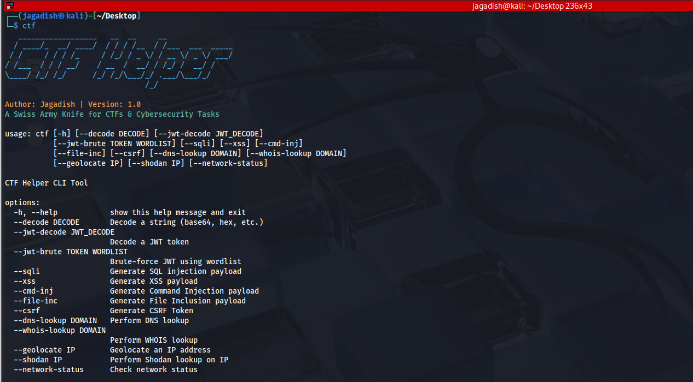

# CTF Helper

A command-line companion for CTFs and authorized cybersecurity testing.



## Features

- Base64, hex, and URL decoding
- JWT inspection and offline HS256 wordlist testing
- Example SQL injection, XSS, command-injection, and file-inclusion payload generation
- DNS, WHOIS, IP geolocation, and Shodan lookups
- Modular CLI design

> Use testing features only against systems you own or are explicitly authorized to assess. JWT wordlist testing can consume significant CPU and should only be performed with permission.

## Requirements

- Python 3.12 or newer
- A virtual environment is recommended

## Installation

```bash
git clone https://github.com/jagdishtripathy/ctf-helper.git
cd ctf-helper

python3 -m venv .venv
source .venv/bin/activate
python -m pip install --upgrade pip
python -m pip install -r requirements.txt
python ctf --help
```

On Windows PowerShell, activate the virtual environment with:

```powershell
.venv\Scripts\Activate.ps1
```

## Usage

Decode a string:

```bash
python ctf --decode SGVsbG8gd29ybGQh
```

Decode a JWT without verifying its signature:

```bash
python ctf --jwt-decode 'eyJhbGciOiJIUzI1NiIsInR...'
```

Test a JWT HMAC secret against a wordlist you are authorized to use:

```bash
python ctf --jwt-brute '<JWT>' /path/to/wordlist.txt
```

Look up DNS or WHOIS data:

```bash
python ctf --dns-lookup example.com
python ctf --whois-lookup example.com
```

Get IP geolocation data:

```bash
python ctf --geolocate 8.8.8.8
```

### Shodan API setup

The Shodan API key is not stored in the source code. Set it in your shell before using Shodan:

Linux/macOS:

```bash
export SHODAN_API_KEY='your-shodan-api-key'
python ctf --shodan 1.1.1.1
```

Windows PowerShell:

```powershell
$env:SHODAN_API_KEY = "your-shodan-api-key"
python ctf --shodan 1.1.1.1
```

Do not commit API keys or other secrets to Git. If a key has previously been committed, revoke or rotate it because removing it from the latest source does not remove it from Git history.

## Dependency and security checks

Dependencies are pinned in `requirements.txt`. Dependabot is configured to propose weekly updates, and GitHub Actions runs dependency auditing and basic CLI checks.

For a local audit:

```bash
python -m pip install pip-audit
pip-audit -r requirements.txt
```

## Contributing

Pull requests are welcome. For major changes, open an issue first, then submit a focused pull request with test results.

## License

See [LICENSE](LICENSE).
